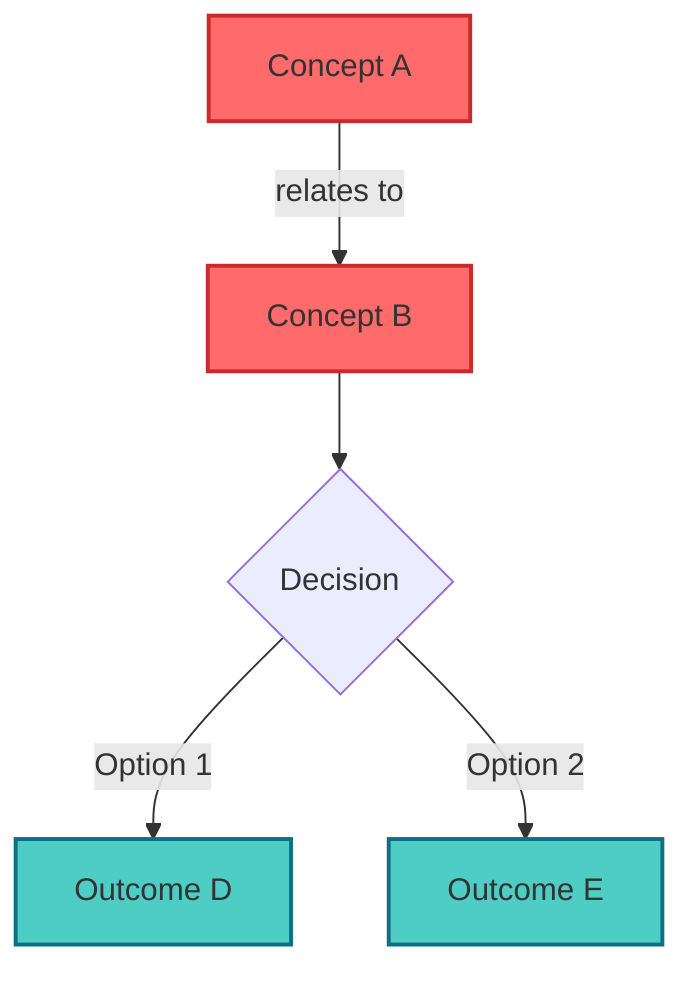
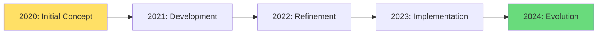
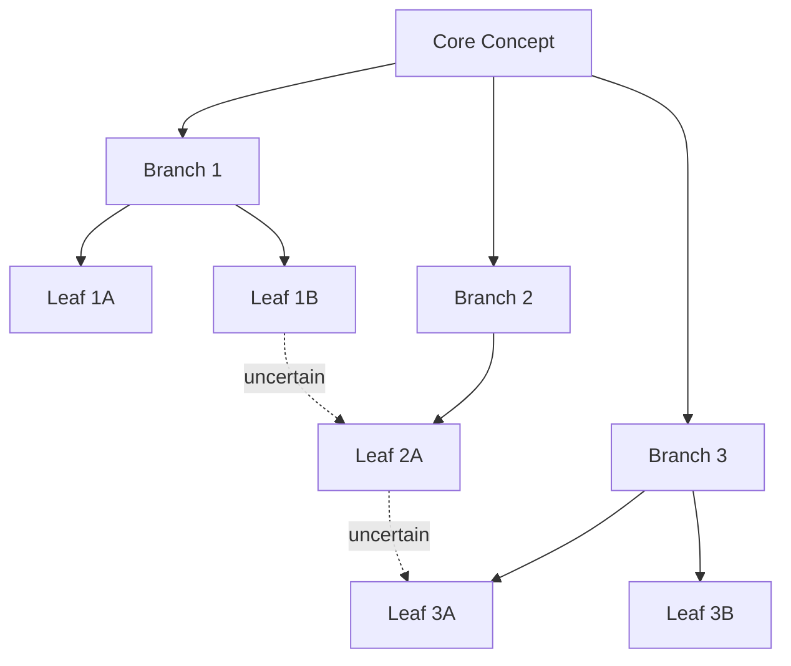

# Visualization Implementation Templates

This file contains ready-to-use implementation templates for various visualization libraries.

## PyVis Knowledge Graph

PyVis is a Python library for creating interactive network graphs.

### Configuration Template

```json
{
  "template_name": "interactive_knowledge_graph",
  "configuration": {
    "physics": {
      "enabled": true,
      "stabilization": {
        "iterations": 100
      }
    },
    "nodes": {
      "shape": "dot",
      "scaling": {
        "min": 10,
        "max": 30
      }
    },
    "edges": {
      "smooth": {
        "type": "continuous"
      }
    },
    "interaction": {
      "hover": true,
      "navigationButtons": true
    },
    "layout": {
      "improvedLayout": true
    }
  }
}
```

### Python Implementation Example

```python
from pyvis.network import Network

# Create network
net = Network(height="750px", width="100%", bgcolor="#222222", font_color="white")

# Configure physics
net.set_options("""
{
  "physics": {
    "enabled": true,
    "stabilization": {"iterations": 100}
  },
  "nodes": {
    "shape": "dot",
    "scaling": {"min": 10, "max": 30}
  },
  "edges": {
    "smooth": {"type": "continuous"}
  },
  "interaction": {
    "hover": true,
    "navigationButtons": true
  }
}
""")

# Add nodes and edges
net.add_node(1, label="Concept A", size=20, color="#FF6B6B")
net.add_node(2, label="Concept B", size=15, color="#4ECDC4")
net.add_edge(1, 2, title="relates to")

# Generate and save
net.show("knowledge_graph.html")
```

## D3.js Force Layout

D3.js is a JavaScript library for creating dynamic, interactive data visualizations.

### Force Simulation Template

```json
{
  "template_name": "d3_force_knowledge_map",
  "forces": {
    "charge": { "strength": -30 },
    "link": { "distance": 30 },
    "collision": { "radius": "d => d.radius" },
    "center": { "x": "width/2", "y": "height/2" }
  }
}
```

### JavaScript Implementation Example

```javascript
// Setup SVG
const width = 960;
const height = 600;

const svg = d3.select("body")
  .append("svg")
  .attr("width", width)
  .attr("height", height);

// Define simulation
const simulation = d3.forceSimulation(nodes)
  .force("link", d3.forceLink(links).distance(30))
  .force("charge", d3.forceManyBody().strength(-30))
  .force("center", d3.forceCenter(width / 2, height / 2))
  .force("collision", d3.forceCollide().radius(d => d.radius));

// Create links
const link = svg.append("g")
  .selectAll("line")
  .data(links)
  .enter().append("line")
  .attr("stroke-width", d => Math.sqrt(d.value))
  .attr("stroke", "#999");

// Create nodes
const node = svg.append("g")
  .selectAll("circle")
  .data(nodes)
  .enter().append("circle")
  .attr("r", d => d.radius)
  .attr("fill", d => d.color)
  .call(d3.drag()
    .on("start", dragstarted)
    .on("drag", dragged)
    .on("end", dragended));

// Add labels
const label = svg.append("g")
  .selectAll("text")
  .data(nodes)
  .enter().append("text")
  .text(d => d.name)
  .attr("font-size", 12)
  .attr("dx", 12)
  .attr("dy", 4);

// Tick function
simulation.on("tick", () => {
  link
    .attr("x1", d => d.source.x)
    .attr("y1", d => d.source.y)
    .attr("x2", d => d.target.x)
    .attr("y2", d => d.target.y);

  node
    .attr("cx", d => d.x)
    .attr("cy", d => d.y);

  label
    .attr("x", d => d.x)
    .attr("y", d => d.y);
});

// Drag functions
function dragstarted(event, d) {
  if (!event.active) simulation.alphaTarget(0.3).restart();
  d.fx = d.x;
  d.fy = d.y;
}

function dragged(event, d) {
  d.fx = event.x;
  d.fy = event.y;
}

function dragended(event, d) {
  if (!event.active) simulation.alphaTarget(0);
  d.fx = null;
  d.fy = null;
}
```

## Cytoscape.js

Cytoscape.js is a graph theory library for visualization and analysis.

### Configuration Template

```javascript
const cy = cytoscape({
  container: document.getElementById('cy'),

  elements: [
    { data: { id: 'a', label: 'Node A' } },
    { data: { id: 'b', label: 'Node B' } },
    { data: { id: 'ab', source: 'a', target: 'b' } }
  ],

  style: [
    {
      selector: 'node',
      style: {
        'background-color': '#666',
        'label': 'data(label)',
        'width': 'data(size)',
        'height': 'data(size)'
      }
    },
    {
      selector: 'edge',
      style: {
        'width': 3,
        'line-color': '#ccc',
        'target-arrow-color': '#ccc',
        'target-arrow-shape': 'triangle',
        'curve-style': 'bezier'
      }
    }
  ],

  layout: {
    name: 'cose',
    idealEdgeLength: 100,
    nodeOverlap: 20,
    refresh: 20,
    fit: true,
    padding: 30,
    randomize: false,
    componentSpacing: 100,
    nodeRepulsion: 400000,
    edgeElasticity: 100,
    nestingFactor: 5,
    gravity: 80,
    numIter: 1000,
    initialTemp: 200,
    coolingFactor: 0.95,
    minTemp: 1.0
  }
});
```

## Sigma.js

Sigma.js is a JavaScript library dedicated to graph drawing.

### Configuration Template

```javascript
import Graph from "graphology";
import Sigma from "sigma";

// Create graph
const graph = new Graph();

// Add nodes
graph.addNode("node1", {
  x: 0,
  y: 0,
  size: 10,
  label: "Node 1",
  color: "#FF6B6B"
});

graph.addNode("node2", {
  x: 1,
  y: 1,
  size: 15,
  label: "Node 2",
  color: "#4ECDC4"
});

// Add edges
graph.addEdge("node1", "node2", {
  size: 3,
  color: "#999"
});

// Render
const renderer = new Sigma(graph, document.getElementById("container"), {
  renderEdgeLabels: true,
  enableEdgeClickEvents: true,
  enableEdgeWheelEvents: true,
  defaultNodeColor: "#999",
  defaultEdgeColor: "#ccc",
  labelFont: "Arial",
  labelSize: 14,
  labelWeight: "normal",
  zIndex: true
});
```

## Mermaid Concept Diagram

Mermaid is a JavaScript-based diagramming tool that uses markdown-inspired text definitions.

### Configuration Template

```json
{
  "template_name": "concept_relationship_diagram",
  "syntax": "graph TD",
  "style_classes": ["tension", "synthesis", "evolution", "uncertainty"]
}
```

### Mermaid Syntax Examples

#### Basic Graph



#### Timeline Flow



#### Network Diagram



## Implementation Decision Matrix

Use this matrix to select the appropriate visualization library:

| Library | Best For | Interactivity | Performance | Learning Curve |
|---------|----------|---------------|-------------|----------------|
| **PyVis** | Quick Python prototypes | Medium | Medium | Low |
| **D3.js** | Custom, complex visualizations | High | High | High |
| **Cytoscape.js** | Network analysis | High | High | Medium |
| **Sigma.js** | Large graphs (10k+ nodes) | High | Very High | Medium |
| **Mermaid** | Documentation, simple diagrams | Low | High | Very Low |

## Performance Optimization Techniques

### For Large Graphs (1000+ nodes)

1. **Viewport Culling**
   - Only render nodes visible in current viewport
   - Use spatial indexing (quadtree, R-tree)

2. **Level of Detail**
   - Reduce node complexity when zoomed out
   - Show simplified representations at distance

3. **Progressive Loading**
   - Load core structure first
   - Stream in details as needed
   - Paginate large datasets

4. **WebGL Rendering**
   - Use GPU acceleration for large datasets
   - Consider Sigma.js or custom WebGL solution

### Code Example: Viewport Culling with D3

```javascript
const visible = nodes.filter(node => {
  const margin = 50;
  return node.x >= -margin && node.x <= width + margin &&
         node.y >= -margin && node.y <= height + margin;
});

// Only render visible nodes
const nodeSelection = svg.selectAll("circle")
  .data(visible, d => d.id);

nodeSelection.enter().append("circle")
  .merge(nodeSelection)
  .attr("cx", d => d.x)
  .attr("cy", d => d.y)
  .attr("r", d => d.radius);

nodeSelection.exit().remove();
```

## Accessibility Guidelines

### Color Accessibility

```javascript
// Use colorblind-safe palettes
const colorBlindSafePalette = [
  "#E69F00", // Orange
  "#56B4E9", // Sky Blue
  "#009E73", // Green
  "#F0E442", // Yellow
  "#0072B2", // Blue
  "#D55E00", // Vermillion
  "#CC79A7"  // Reddish Purple
];
```

### Keyboard Navigation

```javascript
// Enable keyboard navigation
cy.on('tap', 'node', function(evt){
  var node = evt.target;
  node.select();
});

document.addEventListener('keydown', function(e) {
  if (e.key === 'Tab') {
    e.preventDefault();
    // Move to next node
    const selected = cy.$('node:selected');
    const next = selected.neighborhood('node').first();
    selected.unselect();
    next.select();
  }
});
```

### Screen Reader Support

```javascript
// Add ARIA labels
node.append("title")
  .text(d => `${d.name}: ${d.description}`);

svg.attr("role", "img")
   .attr("aria-label", "Knowledge graph showing relationships between concepts");
```

## Export and Sharing

### SVG Export (D3.js)

```javascript
function exportSVG() {
  const svgData = document.querySelector("svg").outerHTML;
  const blob = new Blob([svgData], { type: "image/svg+xml" });
  const url = URL.createObjectURL(blob);

  const link = document.createElement("a");
  link.href = url;
  link.download = "visualization.svg";
  link.click();
}
```

### PNG Export (Canvas-based)

```javascript
function exportPNG() {
  const canvas = document.querySelector("canvas");
  canvas.toBlob(blob => {
    const url = URL.createObjectURL(blob);
    const link = document.createElement("a");
    link.href = url;
    link.download = "visualization.png";
    link.click();
  });
}
```

### JSON Data Export

```javascript
function exportJSON() {
  const data = {
    nodes: cy.nodes().map(node => node.data()),
    edges: cy.edges().map(edge => edge.data())
  };

  const blob = new Blob([JSON.stringify(data, null, 2)],
    { type: "application/json" });
  const url = URL.createObjectURL(blob);

  const link = document.createElement("a");
  link.href = url;
  link.download = "graph-data.json";
  link.click();
}
```
